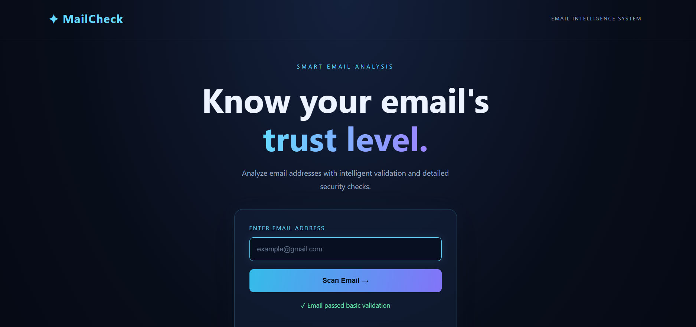
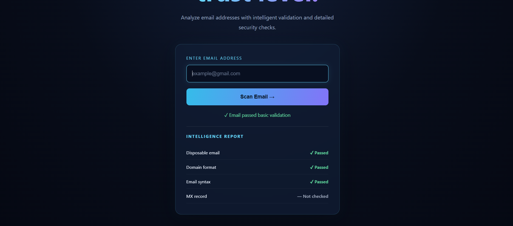
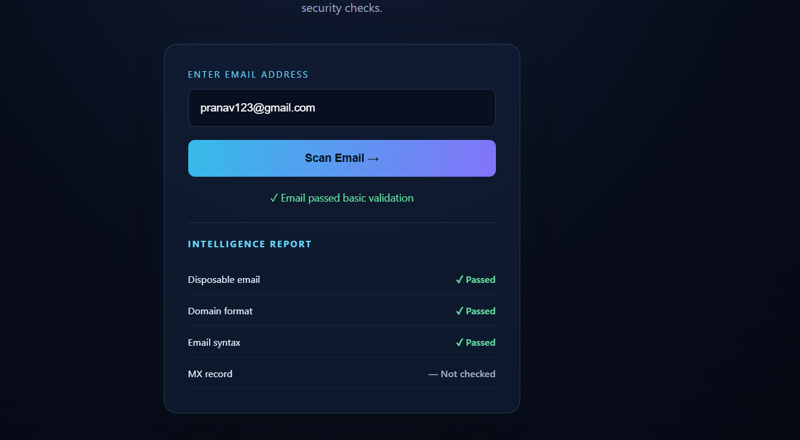
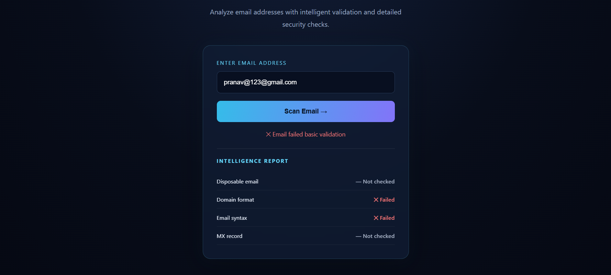

# MailCheck - Email Validation Platform

MailCheck is a web-based application developed to validate email addresses and provide useful information about them. The main idea behind this project was to go beyond basic email validation and build a tool that helps users understand whether an email address follows the correct format and belongs to a potentially disposable email domain.

The application uses Python and Flask for the backend, along with HTML, CSS and JavaScript for the frontend. It provides a simple interface where users can enter an email address and view the validation results.

## Features

- Email syntax validation using regular expressions.
- Domain format checking.
- Disposable email detection.
- Individual validation results displayed in a report.
- Interactive interface with a modern dark theme.
- Frontend and backend integration using Flask.

## Technologies Used

- Python
- Flask
- HTML5
- CSS3
- JavaScript
- Regular Expressions

## Project Structure

```text
MailCheck/
├── app.py
├── templates/
│   └── index.html
├── static/
│   ├── style.css
│   └── script.js
├── screenshots/
│   ├── homepage.png
│   ├── valid-email.png
│   ├── valid-report.png
│   └── invalid-email.png
└── .gitignore
```

## Screenshots

### Homepage


### Valid Email


### Validation Report


### Invalid Email


## How to Run the Project

1. Clone the repository:

```bash
git clone https://github.com/pranav-2908/MailCheck.git
```

2. Navigate to the project folder:

```bash
cd MailCheck
```

3. Install Flask:

```bash
python -m pip install flask
```

4. Run the application:

```bash
python app.py
```

5. Open your browser and visit:

```text
http://127.0.0.1:5000
```

## How It Works

Users enter an email address and click the Scan Email button. The frontend sends the address to the Flask backend, where the configured validation checks are performed. The results are then returned and displayed in an easy-to-understand report.

## Future Improvements

- MX record and DNS checking.
- SPF, DKIM and DMARC analysis.
- Improved disposable email detection.
- Domain typo detection.
- Email trust score calculation.
- Bulk email validation.
- Downloadable validation reports.

## About the Project

MailCheck was developed as a learning project to gain practical experience in Python, Flask and frontend development. It helped me understand how frontend and backend components communicate and how a web application can be developed from scratch.

## Author

**Pranav Shetty**

GitHub: [pranav-2908](https://github.com/pranav-2908)
